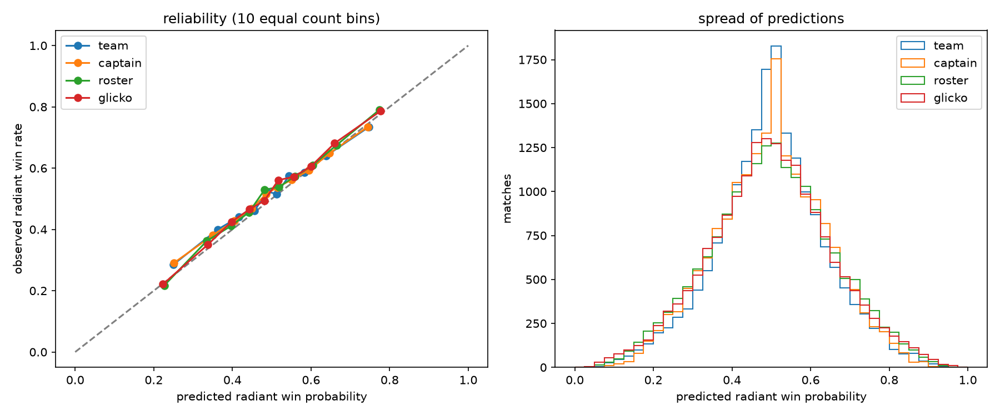

# Dota 2 Professional Match Dataset analysis

Predicting the winner of professional Dota 2 matches from rating systems built on match
history alone — no in-game state, no odds, nothing but who played and who won.

The short version: **roster Elo reaches a log loss of 0.641 on held-out matches from
2025-02 to 2026-10, against a baseline of 0.693.** Rating players individually and
averaging them is worth about 1.7x as much as rating teams. Almost everything
tried after that — Glicko, hero drafts, time-varying hero weights — added little or
nothing.

## Data

Source: [OpenDota's explorer](https://www.opendota.com/explorer). Bare SQL lets you query
the tables in many interesting ways, but there is a query timeout, which means a single
query for the whole history will not return. The fix is to batch: `fetch_data.py` splits
the pull by patch, using OpenDota's own `match_patch` table, into seven groups sized to be
roughly even, and checks each response against a `count(*)` so a truncated reply is caught
rather than silently written out short.

After filtering to `premium` and `professional` tiers and dropping matches without both
team ids or complete player rows:

| | |
|---|---|
| Matches | 210,238 |
| Date range | 2012-06-05 to 2026-10-09 |
| Player rows | 2,523,950 |
| Distinct players | 109,147 |
| Distinct teams | 20,646 |
| Distinct captains | 21,873 |
| Patches | 57 |
| Heroes | 127 |

## How the models are evaluated

Everything below runs through one pipeline, `evaluate.py`, so the comparison is like for
like. Four decisions in it matter more than any of the models:

**Each match is predicted before it is learned from.** Every model walks the full history
in time order, emits a probability, and only then updates its ratings. One pass therefore
produces honest predictions for every period at once, and no prediction can see its own
result or anything later.

**Hyperparameters are chosen on a validation period, never on the test period.** History is
cut into seven chunks by `start_time` quantiles. Fold *f* trains on everything before chunk
*f−1*, picks its parameter on chunk *f−1*, and is scored once on chunk *f*. That gives five
walk-forward folds, so each result comes with a spread rather than being a single number.
The headline fold is the last 10% of matches, 2025-02-13 onward.

**The baseline is computed on the test matches.** It is the constant guess equal to the
radiant win rate observed *before* the test period, scored on the test period. Using the
test period's own win rate instead would be cheating; it happens to give almost the same
number (0.6926 against 0.6929), but the honest version is the one quoted.

**The burn-in filter is identical for every model.** A match is only scored once both sides
average more than 10 prior games, where "prior games" counts matches strictly before the
one being scored. This is model-independent, so every model is judged on exactly the same
176,118 of 210,238 matches. An earlier version counted the current match too, which was an
off-by-one.

## The journey

### 1. Team Elo

The obvious starting point: one rating per `team_id`, standard Elo update, K tuned.

It works, but barely. Held out, it beats the baseline by 0.030. The problem is churn —
20,646 team ids over 14 years, and a "team" is an organisation that swaps its entire roster
between seasons while keeping the same id. The rating tracks a brand, not a group of
people.

### 2. Captain Elo

Second attempt: key the rating on `radiant_captain` / `dire_captain` instead, on the theory
that a captain is a more stable proxy for a particular group of players than an org is.

It made essentially no difference: 0.6619 against team Elo's 0.6627, a gap of 0.0008 that
is inside the noise. Across the five folds the two are indistinguishable (0.66868 against
0.66868). Captains also go missing — 6.5% of matches have no captain recorded, and those
fall back to a 0.5 prediction, which costs a little.

The useful thing this ruled out: the problem was not *which single entity* to attach the
rating to. Any one-rating-per-side scheme was going to hit the same ceiling.

### 3. Roster Elo

The step that actually worked. Rate every player individually; a side's rating is the mean
of its five players; the whole side shares the same update.

Held-out log loss drops to 0.6410, a gain of 0.0519 over baseline, and it beats team Elo by
**0.0217 ± 0.0016** on paired per-match differences. That is the one large, unambiguous
effect in this whole project. Ratings attached to people survive roster changes; ratings
attached to orgs do not.

This also forced the data expansion — player-level ratings need `player_matches`, which is
2.5M rows rather than 210k.

The mechanism is visible directly in the data. Splitting at the same 90% cutoff and asking
what fraction of held-out matches involve an entity the model has never rated before:

| Rated entity | Test matches involving an unseen one |
|---|---|
| Team id | 63.1% |
| Captain | 31.3% |
| Any of the ten players | 43.8% |
| — but as a share of all player slots | **20.3%** |

That last row is the whole argument. Rating teams means that in nearly two thirds of
held-out matches at least one side is a blank 1500. Rating players means 80% of the slots
feeding each prediction already carry a real rating, and a side with one new player still
has four rated ones to average over. Averaging degrades gracefully where a single-entity
rating falls off a cliff.

### 4. Glicko

Diagnosis: cold start looked like the bottleneck. A new player enters at 1500 and needs
many games to move, and 26.8% of matches in the earliest chunk have at least one side
averaging 10 or fewer prior games (7–12% in later chunks, 11.9% in the headline test
chunk). Glicko addresses this directly by tracking a
rating deviation per player — new players start at RD 350 and move fast, established
players settle toward a floor of 50 — plus a decay term `C` that lets uncertainty creep
back during inactivity.

The hypothesis was right about the mechanism and wrong about the payoff. Glicko scores
0.6405 against roster Elo's 0.6410, a paired difference of **−0.0005 ± 0.0012** — well
under one standard error. Across five folds, 0.6559 against 0.6571, with fold-to-fold
spread of about 0.010.

Worth recording honestly: on an earlier, smaller version of the dataset (202,735 matches)
this gap looked like 0.0026 ± 0.0011, around 2.3 standard errors, and was nearly written up
as a real improvement. Adding 7,503 matches collapsed it. A two-sigma result on one split
is not a finding.

### 5. Heroes and the draft

Does knowing the ten heroes picked add anything once you already know who is playing?

Tested as a designed ablation rather than a new rating system. A logistic regression on the
roster Elo rating difference (on the logit scale) is the control; the treatment adds one
column per hero, +1 if radiant picked it and −1 if dire did, with the hero weights L2
penalised and the penalty tuned on validation.

The draft adds **0.0017 ± 0.0004**, about four standard errors, and it wins in all five
folds. Real, reproducible, and small — roughly 3% of the gain Elo gets over baseline.

A side observation: the rating-only regression is sometimes slightly *worse* than raw Elo
(0.6577 against 0.6571 on average). A logistic refit on the Elo logit cannot find anything
to correct, which is independent evidence the Elo probabilities are already well calibrated.

### 6. Letting hero effects drift

A hero id means something different in 6.74 than in 7.41, so static hero weights averaged
over 57 patches should be leaving signal behind. Two ways to let them move:

**Recency weighting.** Weight each training match by `0.5 ** (age / half_life)`, with the
half-life tuned on validation over 1 year, 2 years, 4 years and no decay.

**Era-varying weights.** A shared global weight per hero plus a per-era deviation, seven
eras, deviations shrunk harder than the global weights.

Neither helped.

| | mean over 5 folds |
|---|---|
| Rating only | 0.657724 |
| Rating + draft (static) | 0.655639 |
| Rating + draft, recency weighted | 0.655342 |
| Rating + draft, era-varying | 0.655529 |

On the headline fold, recency weighting was *worse* than static by 0.0002 ± 0.0003, and
era-varying differed from static by 0.000009 ± 0.000023 — identical to within optimiser
noise.

The era result has a structural explanation, and it is the interesting part. Training
always ends where the test period begins, so **the era you are predicting is never an era
you have training data for**. Its deviation columns are all-zero during fitting, the
penalty holds them at zero, and the model falls back to the global weight exactly. Era
interaction cannot help at the forecasting frontier by construction. This would have shown
up as a gain under a random split, which is a good illustration of why the split has to be
temporal.

Recency weighting does not have that excuse — validation picked a finite half-life in all
five folds, so there *is* some recency preference in-sample. It just did not transfer.

## Results

Headline: 18,526 eligible matches, 2025-02-13 to 2026-10-09, scored once.

| Model | Log loss | Gain over baseline |
|---|---|---|
| Baseline (constant) | 0.6929 | — |
| Team Elo (K=16) | 0.6627 | 0.0302 ± 0.0020 |
| Captain Elo (K=16) | 0.6619 | 0.0310 ± 0.0021 |
| **Roster Elo (K=16)** | **0.6410** | **0.0519 ± 0.0022** |
| Roster Glicko (C=10) | 0.6405 | 0.0524 ± 0.0022 |
| Roster Elo + draft | 0.6389 | 0.0539 |

Paired per-match differences against roster Elo:

| | difference | standard errors |
|---|---|---|
| Team Elo | +0.0217 ± 0.0016 | 13.9 |
| Captain Elo | +0.0209 ± 0.0018 | 11.5 |
| Glicko | −0.0005 ± 0.0012 | 0.4 |

Walk-forward over five folds:

| Model | Test loss | Gain over baseline |
|---|---|---|
| Team Elo | 0.6687 ± 0.0049 | 0.0247 ± 0.0047 |
| Captain Elo | 0.6687 ± 0.0047 | 0.0247 ± 0.0045 |
| Roster Elo | 0.6571 ± 0.0107 | 0.0362 ± 0.0104 |
| Roster Glicko | 0.6559 ± 0.0095 | 0.0375 ± 0.0091 |

Note the fold-to-fold spread (±0.010) is larger than the Glicko-versus-roster gap (0.0012).
Any single split would have been able to show either model ahead.

## Calibration

Reliability on the headline fold, 10 equal-count bins.



| Model | ECE | std of p | 5th–95th pct | share in 0.45–0.55 |
|---|---|---|---|---|
| Team Elo | 0.0191 | 0.137 | 0.263–0.735 | 33.5% |
| Captain Elo | 0.0200 | 0.140 | 0.261–0.733 | 29.7% |
| Roster Elo | 0.0181 | 0.155 | 0.237–0.763 | 26.1% |
| Roster Glicko | 0.0183 | 0.155 | 0.238–0.764 | 27.1% |

All four are well calibrated — the reliability curves sit close to the diagonal and ECE is
under 0.02 throughout. The predictions are not degenerate, but they are modest: roster Elo's
middle 90% spans 0.24 to 0.76, and a quarter of its predictions fall within 0.05 of a coin
flip. For a pricing application, this is a model that is honest about how little it knows,
rather than one that is confidently wrong.

## Conclusions

**Who is playing matters; what they are called does not.** Moving the rating from the org
to the individual player is worth 0.022 in log loss. Moving it from the org to the captain
is worth nothing. This is the only large effect found.

**Modelling uncertainty was the right diagnosis and the wrong fix.** Cold start really is
present — a quarter of the earliest matches involve a side with almost no history — and
Glicko really does move new players faster. It just does not translate into measurable
accuracy on this data.

**The draft adds a little, and it does not drift usefully.** 0.0017 ± 0.0004 from a static
bag-of-heroes, and zero on top of that from either recency weighting or era-varying weights.
Pro teams ban and pick to balance, so after controlling for roster strength there is not
much left in the hero identities alone.

**Most of the match is not predictable from history.** The best model recovers 0.054 of log
loss against a baseline of 0.693, so roughly 92% of the baseline uncertainty survives. For
professional Dota that is not obviously wrong — these are evenly matched teams playing a
high-variance game — but it does bound what a history-only model can do.

**Evaluation discipline changed the answers more than any model did.** The original
in-sample result, 0.6618 at K=16 against 0.6931, was not a held-out number and its baseline
came from the same data being scored. Two findings that looked real under a weaker protocol
— Glicko's edge, and the prospect of era-varying hero weights — did not survive a proper
temporal split with an honest baseline.

## Known limitations

- Hero weights come from `player_matches.hero_id`, which is the heroes played, not the
  draft. Bans and pick order are in OpenDota's `picks_bans` table and are not used here. A
  banned hero is a feared hero, so there is signal being left behind.
- Heroes and players are confounded; the rating feature absorbs some of this but not all.
- Roughly 6.5% of matches have no captain recorded, which handicaps captain Elo slightly.
- A handful of player rows have no `account_id` (anonymous players) and share a single
  rating. At 79 rows in 2.5M this is negligible.
- Each fold picks its hyperparameter on a single ~19k-match validation chunk, so the choice
  is itself a little noisy. In practice K=16 won nearly everywhere.

## Files

| File | What it does |
|---|---|
| `fetch_data.py` | Pulls every raw table from the OpenDota explorer API — matches, player rows with `hero_id`, teams, leagues, patches — batching the big ones by patch |
| `process_raw.py` | Joins the raw CSVs into `data/processed/*.parquet`, filters to pro tiers, attaches the patch |
| `evaluate.py` | The single held-out pipeline: all four rating models, walk-forward folds, calibration, draft ablation |
| `requirements.txt` | Pinned dependencies |
| `exploration/elo.py` | Original team/captain Elo, in-sample |
| `exploration/player_elo.py` | Original roster Elo |
| `exploration/player_glicko.py` | Original Glicko, with loss broken down by time decile |
| `exploration/main.py` | Where the churn problem was first measured |
| `exploration/team_based_elo.txt` | Saved output from the original in-sample team Elo run |

Everything under `exploration/` is the record of how the model developed, kept deliberately
as it was written. Those scripts score in-sample and take their baselines from training
data, so their numbers are **not** comparable to anything in this README and each one says
so at the top. Every number quoted here comes from `evaluate.py`. Run them from the repo
root, not from inside `exploration/`.

## Reproducing

From a clean clone, with no data files and no API key:

```bash
python -m venv venv
venv/bin/pip install -r requirements.txt
venv/bin/python fetch_data.py     # writes data/raw/, about 10 minutes
venv/bin/python process_raw.py    # writes data/processed/*.parquet
venv/bin/python evaluate.py       # prints every table above, writes calibration.png
```

`fetch_data.py` skips anything already on disk, so an interrupted pull resumes.

The source tables are live and keep growing, so a fresh pull returns slightly more matches
than the 210,238 the numbers above were computed on, and the results will move a little.
The quantile-based chunk boundaries shift with the data by design — they are always the
last 10% of whatever history exists at the time.
`evaluate.py` takes a few minutes, most of it in the draft ablation's hyperparameter grids.
